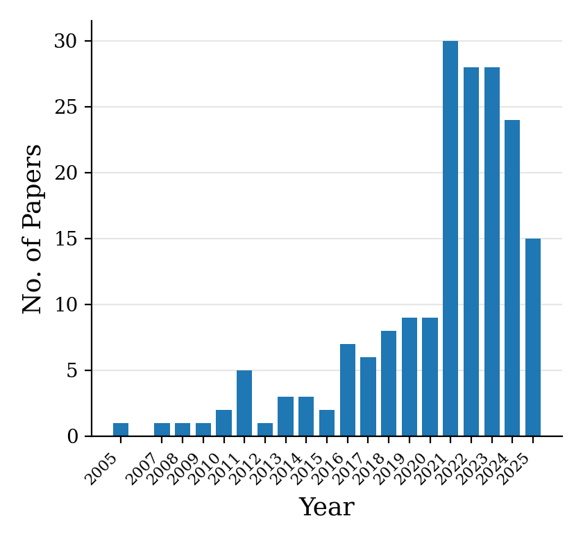

# In-Vehicle Security Survey: Paper List

Papers covered in the survey:

M. Jones, F. Mohsen, U. Rauf, C. Papadopoulos, and S. Shannigrahi. From Entry Point to Impact: A Survey of In-Vehicle Cybersecurity Threats, Mitigations, and Open Research Directions. Vehicular Communications, 2026.

The survey groups in-vehicle attacks by entry point, attack method, impact, and defense, across CAN, LIN, FlexRay, Automotive Ethernet, sensors, wireless links, telematics, V2X, and OTA updates. This repository lists the 184 papers (2005 to 2025) and where each one appears in that grouping.

## Files

| File | Content |
|---|---|
| `papers.csv` | One row per paper: key, year, title, venue, venue type, publisher, topic area, survey sections, link |
| `taxonomy.csv` | One row per paper and section where the survey discusses it |
| `survey.bib` | BibTeX for all papers |
| `figures/` | Papers by year, by publisher and venue type, and by topic area |

## Taxonomy

- **Entry point**
  - Entry Points at the Physical Layer (49 papers)
  - Entry Points at the Data-Link Layer (3 papers)
  - Entry Points at the Application Layer (30 papers)
- **Attack methodology**
  - Manipulation (37 papers)
  - Monitoring and Reconnaissance (8 papers)
  - Disruption (12 papers)
- **Impact**
  - Mechanical and Electrical Anomalies (19 papers)
  - False or Misleading Information (6 papers)
  - Information Leakage and Follow-On Attacks (6 papers)
  - Cross-Cutting Impact Properties (4 papers)
- **Detection and mitigation**
  - Detection and Mitigations at Attack Entry Points (14 papers)
  - Detection and Mitigations Disrupting Attack Methodologies (59 papers)
  - Detection and Mitigations for Impact Containment and Recovery (9 papers)
  - Data-Driven and Semantic Attack Detection (4 papers)

Papers cited only in the introduction, related work, or research gaps sections are listed under `Context`.

## Papers by topic area

| Category | Papers |
|---|---|
| IDS & Anomaly Detection | 48 |
| Surveys & Reviews | 33 |
| Attack Surfaces & Threats | 25 |
| Sensor/GPS/Wireless Attacks | 23 |
| Frameworks, Architecture & Systems | 21 |
| Cryptography & Authentication | 12 |
| Control & Resilience | 10 |
| V2X / ITS Security | 7 |
| Privacy & Trust | 3 |
| DoS & Availability | 2 |



## Citation

```bibtex
@article{jones2026entry,
  title     = {From Entry Point to Impact: A Survey of In-Vehicle Cybersecurity Threats, Mitigations, and Open Research Directions},
  author    = {Jones, Micah and Mohsen, Fadi and Rauf, Usman and Papadopoulos, Christos and Shannigrahi, Susmit},
  journal   = {Vehicular Communications},
  year      = {2026},
  publisher = {Elsevier}
}
```

## Adding papers

Pull requests are welcome. See [CONTRIBUTING.md](CONTRIBUTING.md).

## License

CSV files, figures, and this README: [CC BY 4.0](https://creativecommons.org/licenses/by/4.0/).
